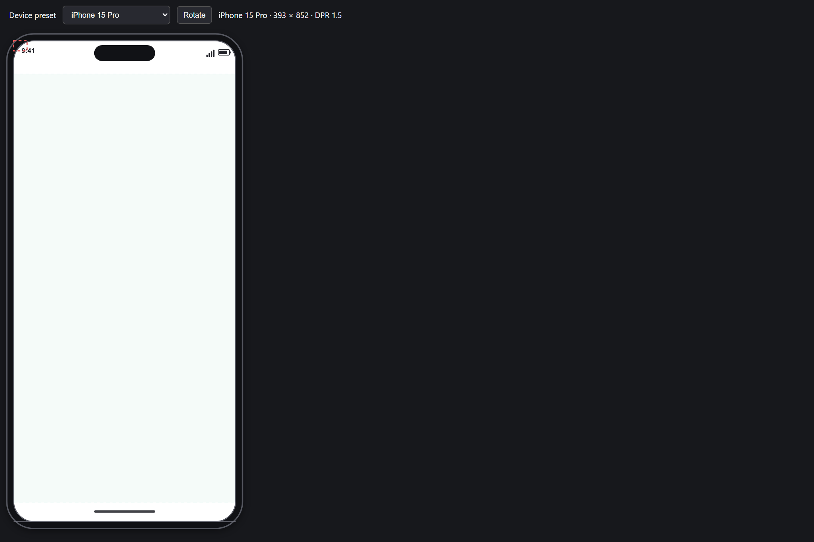

# Device frame and multi-device verification

Updated: 2026-10-25

This report distinguishes automated emulation from physical platform verification.
It must not be read as a claim that every operating system, display server, browser,
or physical device has been tested.

## Verification matrix

| Environment | Display server | DPI | Result |
|---|---|---|---|
| Windows 10 Pro Education, build 26300 (local host) | Native Windows session | 100%, 125%, 150%, 200% Chromium emulation | Full run: all 21 frames at every emulated scale, preview modes/state, rotation, screenshot action, input modes, image export, and responsive/variant HTML export passed. This is not a Windows 11 certification. |
| Ubuntu 24.04 GitHub Actions | Headless browser runner | DPR emulation | PR smoke and post-merge full checks; not a visual test of X11 or Wayland desktop sessions. |
| Windows 11 | Native | 100%, 125%, 150%, 200% | Not verified on a Windows 11 host. |
| Ubuntu 24.04 | X11 | 100%, 125%, 150%, 200% | Not verified in a desktop X11 session. |
| Ubuntu 24.04 | Wayland | 100%, 125%, 150%, 200% | Not verified in a desktop Wayland session. |
| Kali Linux | X11 / Wayland | 100%, 125%, 150%, 200% | Not verified. |
| Debian 12 | X11 / Wayland | 100%, 125%, 150%, 200% | Not verified. |
| Fedora 40 | X11 / Wayland | 100%, 125%, 150%, 200% | Not verified. |
| Arch Linux | X11 / Wayland | 100%, 125%, 150%, 200% | Not verified. |

The local 100%, 125%, 150%, and 200% browser checks use device-scale-factor
emulation; they do not change the host OS display scaling setting. Local full-run
responsive and per-device HTML export checks passed in Chromium, Firefox, and
Playwright WebKit. The Linux CI job runs headless Playwright browsers and does not
establish desktop compositor behavior.

## Device presets

The catalog contains 21 presets. The browser fixture can select each preset and
renders the production `DeviceFrame` Konva component. The full run cycles all 21
through each emulated DPR. Catalog metadata, safe-area bounds, and
orientation round-trips are also unit-tested.

| Category | Presets |
|---|---|
| Phones | iPhone 15 Pro, iPhone 15, iPhone SE, Pixel 8, Pixel 8 Pro, Samsung Galaxy S24, Samsung Galaxy A54 |
| Tablets | iPad Pro 12.9″, iPad Air, iPad Mini, Galaxy Tab S9 |
| Laptops | MacBook Pro 14″, MacBook Air 13″, Dell XPS 13 |
| Desktops | Desktop 1440 × 900, Desktop 1920 × 1080, Desktop 2560 × 1440, Desktop 4K 3840 × 2160, Desktop 1366 × 768 |
| Watches | Apple Watch Series 9, Wear OS Round |

The interactive fixture is available at [device-frame-fixture.html](../scripts/device-frame-fixture.html).
It presents the catalog presets in a picker, shows safe-area overlays and out-of-area
warnings, and allows portrait/landscape rotation. The [device-presets.pflow](../examples/device-presets.pflow)
example project contains a named screen, device metadata, breakpoints, and safe-area
content for each of the 21 presets.

## Tested behavior

- Device preset viewport and safe-area geometry, valid screen-device data, all four
  documented scale factors, and double-rotation round trips.
- Frame rendering through the production Konva component, including bezel, browser
  chrome, status indicators, safe-area overlays, and warnings for unsafe widgets.
- Preview single-device, three-column, and custom-grid layouts; four simultaneous
  frames share the same runtime variable state.
- Portrait/landscape preview rotation and the preview's 2× PNG screenshot action.
- Mouse and emulated-touch interaction filters in `mouse`, `touch`, and `both` modes.
- Responsive HTML export at mobile (390 px), tablet (768 px), and desktop (1280 px)
  browser widths, including the mobile widget override. Chromium, Firefox, and
  Playwright WebKit all pass this export check in the full run.
- Per-device image archive entries have PNG pixel dimensions in exact 1×, 2×, and
  3× ratios. This task expands image export from 2× only to all three ratios.
- Existing tests cover breakpoint cascade modes, overflow warnings, persisted
  breakpoints and widget overrides, rich-text output, and React responsive source
  transpilation.

The React export test compiles generated TSX with TypeScript; it does not run
`npm install` and a generated React project's development server. The Playwright
WebKit build is a browser engine check, not certification of Safari on macOS.
Touch is emulated in Chromium; no physical touch device was used.

## DPI screenshots

Screenshots are captured from the multi-device preview and device-frame fixture.
The scale shown is Playwright's emulated device scale factor on the local Windows
host, not a screenshot from a separate OS display configuration.

### 100%

### 125%

### 150%

### 200%

Multi-device preview captures are in the same screenshots folder. CI uploads both
sets as the `device-verification-<run id>` workflow artifact.

## CI and local commands

- Every pull request to `main`: focused device/breakpoint/export tests and Chromium
  browser smoke across the four emulated DPRs and representative device categories.
- Push/merge to `main`: full preset-by-DPR fixture traversal plus responsive export
  checks in Chromium, Firefox, and WebKit.
- Run locally with `npm run verify:devices`.
- Run the post-merge scope locally with `$env:PF_DEVICE_FULL='1'; npm run verify:devices`
  in PowerShell.

## Known limitations and follow-up

- This environment reports Windows 10 Pro Education (build 26300), not Windows 11.
  No Kali, Debian, Fedora, Arch, or Ubuntu desktop session was available. Their
  X11/Wayland combinations remain unverified.
- Screenshots cover one representative phone frame plus the multi-device preview
  at each DPR, not visual baselines for every preset. CI currently checks successful
  render, safe-area/geometry behavior, and export dimensions; it does not compare
  pixel snapshots or send visual-change alerts.
- The headless Linux workflow verifies browser behavior, not native Tauri desktop
  rendering on each Linux distribution.
- System-font fallback and rich-text data/output have unit coverage, but fonts have
  not been visually compared across operating systems.
- The combined sample project includes a screen per preset; it does not contain 21
  separate `.pflow` files. The schema tests round-trip device metadata in project files.
